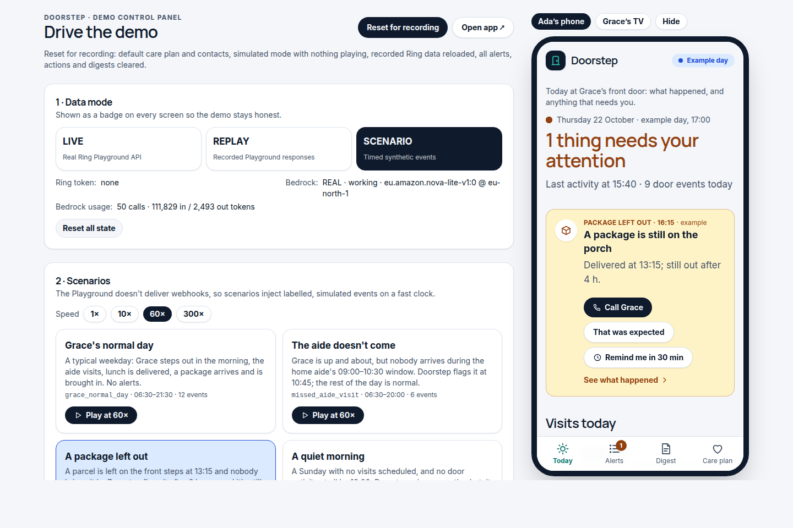
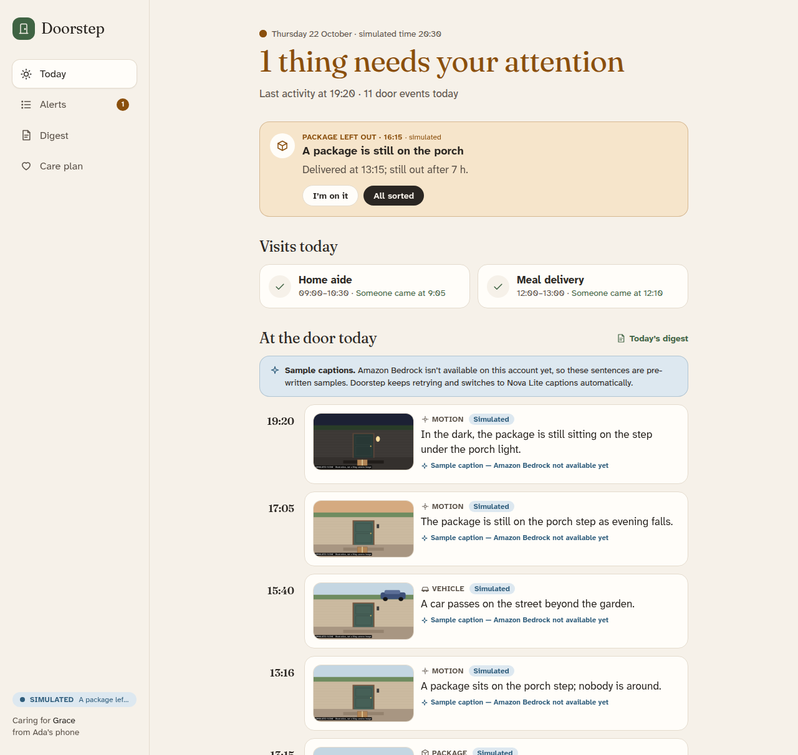
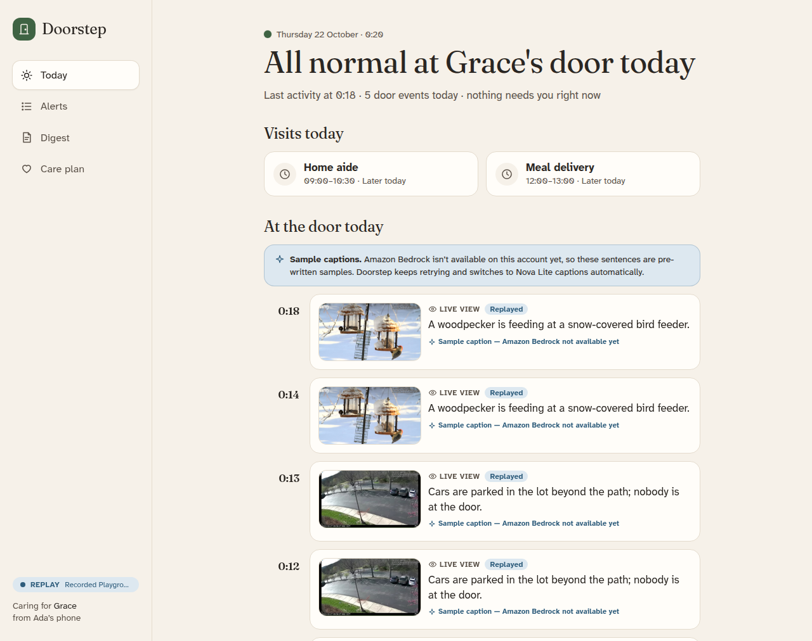
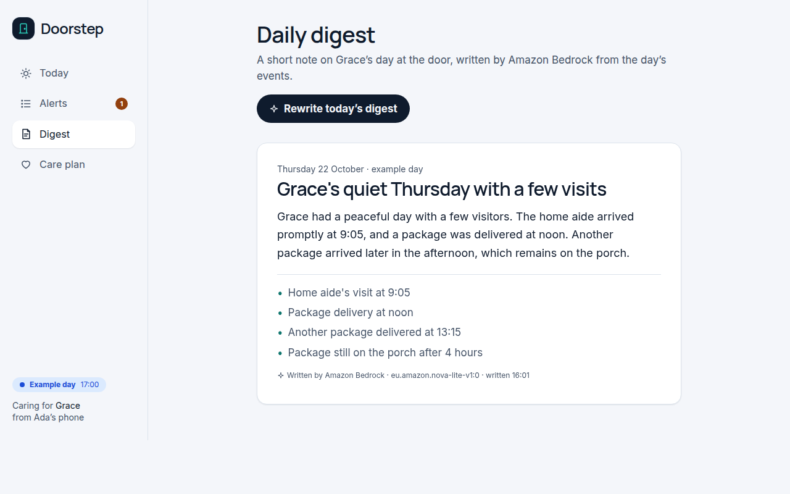
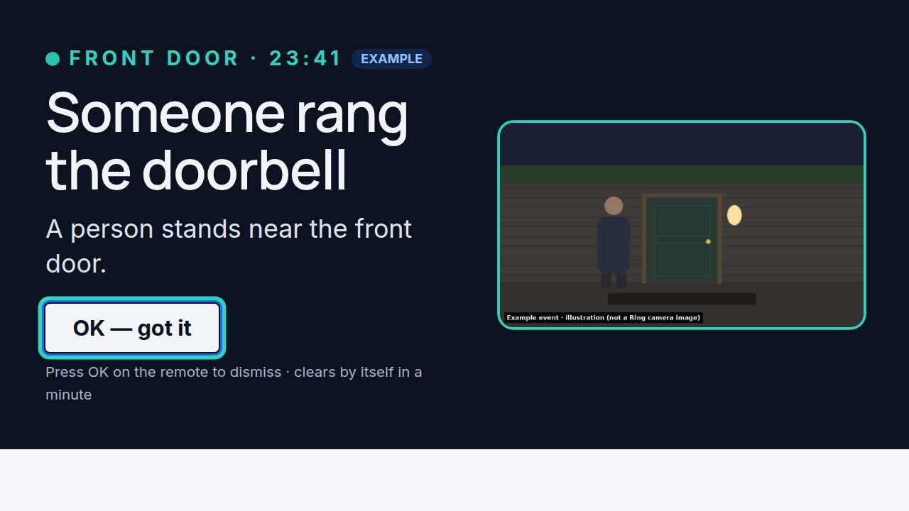
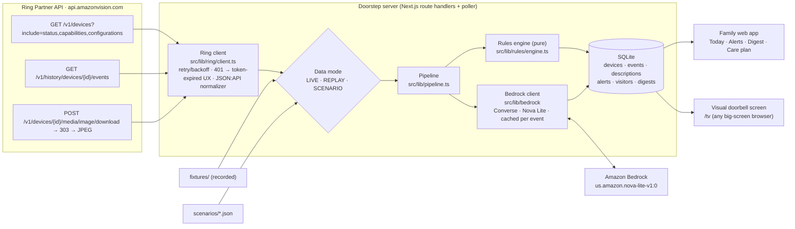

# Doorstep

**A caretaking companion for families looking after a parent who lives alone, built on the Ring Partner API and Amazon Bedrock.**

> Ada lives in another city. Her mother Grace lives alone. Doorstep tells Ada when something is off, and leaves her alone when it isn't.

Doorstep turns raw Ring front-door events into calm, plain-language information a family member actually wants:

- **AI event descriptions.** Each Ring snapshot is described by Amazon Bedrock (Nova Lite) in one plain sentence: *"A courier in a high-visibility vest leaves a package on the step."* It describes what happens and **never identifies people**.
- **Caretaking alerts** from a deterministic, unit-tested rules engine: quiet morning, missed visit, package left out, late-night door activity, unanswered doorbell (best-effort).
- **Alerts that explain themselves.** Each alert opens to the full snapshot, its caption, and a care-plan-specific reason ("Doorbell at 23:41 — outside Grace's usual hours, 05:00–23:00"), plus what else happened at the door within ±10 minutes.
- **Caretaker actions.** Call Grace or the aide/neighbour (`tel:` links from the care plan's contacts), **That was expected** (optionally add the visitor to the schedule), or **Remind me in 30 min**, with a per-alert history. Unacknowledged urgent alerts escalate in-app to a second family contact after 15 minutes.
- **Look now** (experimental): a WebRTC live view of the Ring camera via the Partner API's WHEP endpoint, proxied server-side so the token never reaches the browser.
- **Daily digest.** A short, warm Bedrock-written note on the parent's day at the door.
- **Visual doorbell for the living room.** A full-screen, high-contrast "someone is at the door" page (`/tv`), for deaf or hard-of-hearing residents who can't hear the chime. It runs in any big-screen browser. (A native Fire TV app was planned; we dropped it, see friction log F-14.)

| Ada's phone when something's off (simulated day, driven from `/demo`) | A day with a package left out |
|---|---|
|  |  |
| **Real Ring Developer Playground data** in REPLAY: watermarked 1080p snapshots | **Daily digest** |
|  |  |

**Visual doorbell** (`/tv`) for residents who can't hear the chime:



> Captions in these screenshots are labelled **sample captions**. Our AWS account's Nova Lite quota is still 0 (see [FRICTION_LOG F-08](FRICTION_LOG.md)). The Bedrock path is built and switches on automatically once calls succeed. Scenario images are drawn illustrations stamped "SIMULATED SCENE"; the REPLAY images are real Ring Playground frames.

## Run it (under 5 commands)

```bash
git clone https://github.com/breakthrough-child/doorstep.git && cd doorstep
npm install
npm run setup
npm run dev
```

Open <http://localhost:3000>. Onboarding offers **Skip — use demo data**, which starts on replayed Ring data. Open **<http://localhost:3000/demo>** to switch data modes and play scenarios.

No credentials are needed for a first run: REPLAY mode plus labelled sample captions. To use real services, copy `.env.example` to `.env.local` and add AWS credentials (Bedrock, default `eu-north-1` with `eu.amazon.nova-lite-v1:0`) and/or a Ring Developer Playground token. Check Bedrock access with `npm run check:bedrock`. See [docs/AWS.md](docs/AWS.md).

Requirements: Node 20.9+ (tested on Node 22, Ubuntu 24.04). `better-sqlite3` ships prebuilt binaries for common platforms.

## Data modes: what's live, what's replayed, what's simulated

The Ring Developer Playground gives sandbox API access without hardware, but its tokens last ~30 minutes and **it doesn't deliver webhooks**. So Doorstep has three data modes. The current one is always shown as a badge on every screen.

| Mode | Badge | Ring data | Events | Snapshots |
|---|---|---|---|---|
| `LIVE` | **Live** (green) | Real Playground API calls with your token | Polled from Event History every 30 s | Real, watermarked Ring images |
| `REPLAY` (default) | **Replay** (blue) | Real Playground responses recorded on Oct 21 in `fixtures/playground/` (devices, 6 history events: package, vehicle and motion simulations), pushed through the same JSON:API normalizer | Recorded events, time-shifted to today | Real 1920×1080 Ring snapshots with the mandatory watermark |
| `SCENARIO` | **Simulated** (blue) | Replayed devices | Timed synthetic events on a simulated clock, each labelled "Simulated" | Drawn illustrations stamped "SIMULATED SCENE" (never fake Ring images) |

- Record your own fixtures: trigger a few event simulations in the Playground, then `RING_ACCESS_TOKEN=… npm run record`. A fresh token has an empty history, so simulate first. The token is never written to disk; the recorder refuses to save any file containing it.
- Scenarios: `grace_normal_day`, `missed_aide_visit`, `package_left_out`, `quiet_morning`, `late_night_ding`. Play at 1×/10×/60×/300× from `/demo`.
- **Coverage-aware.** The Playground only authorizes data from each token's issue time. Doorstep tracks when its view of the door began ("watching since 23:43") and never raises "nobody came" alerts for time it couldn't see.
- The Playground's simulated events all arrive as `on_demand` (live view) with no package/person subtype (friction F-12). That's why the caretaking rules are demonstrated with labelled SCENARIO days.

## Architecture



- **Ring client** (`src/lib/ring/`): typed responses, `?include=` + `included` resolution by type+id, newest-first pagination via `links.next` `page[key]`, exponential backoff that honours `Retry-After` on 429/5xx, `RingTokenExpiredError` on 401 driving the "paste a new Playground token" banner, and the snapshot 303 → pre-signed URL hop done manually without forwarding the Bearer token. It's imported and called at runtime by the poller, the token-check endpoint and the fixture recorder.
- **Pipeline** (`src/lib/pipeline.ts`): ingest → snapshot → Bedrock caption → rules → alerts. Single-flight `tick()` run by a 1.5 s poller (`src/instrumentation.ts`) and by `/api/state`.
- **Rules engine** (`src/lib/rules/engine.ts`): pure functions of (events, care plan, now), evaluated in the parent's time zone, with deterministic alert ids so a family's "I'm on it" survives re-evaluation. Covered by Vitest, including DST days.
- **Bedrock** (`src/lib/bedrock/`): Converse with image + text in, strict JSON out, tolerant parsing with fallbacks, results cached by event id, token usage logged per call. If Bedrock is unavailable (our account's Nova Lite quota is currently 0, see the friction log), events get clearly labelled sample captions and the app switches to real captions automatically once calls succeed. Details and costs: [docs/AWS.md](docs/AWS.md).

## Privacy stance

- **No face recognition, no biometric matching, no identification. Ever.** The vision prompt forbids naming or recognising anyone or guessing personal traits. "Missed visit" means *nobody* came to the door in the window, not that a specific person didn't. Visitor names are labels for the family only.
- **Ring's watermark stays intact.** Snapshots are always displayed uncropped (`object-contain`) at full size.
- **Secrets stay server-side.** The Ring token and AWS credentials are only used in route handlers; the browser never receives them. Pasted tokens live in the local SQLite file (`data/`, git-ignored).
- **Data stays local.** Everything is stored in a local SQLite file. Snapshots go to Bedrock for captioning (not stored by Bedrock for training, per AWS's Bedrock data policy) and nowhere else.
- Doorstep reads privacy-zone and end-to-end-encryption settings from device configurations. E2EE devices aren't exposed by the Partner API at all.

## Tests

```bash
npm test
```

Vitest covers every alert rule (edge cases, wrapping late-night windows, DST spring-forward/fall-back, other time zones), JSON:API normalization, the Ring client (retry/backoff, 401, pagination, the snapshot redirect), model-output parsing, and that each scenario fires exactly the alerts it's designed to show.

## Project docs

- [SUBMISSION.md](SUBMISSION.md): Devpost answers and product feedback
- [FRICTION_LOG.md](FRICTION_LOG.md): every real problem we hit with Ring, the Playground, Bedrock and Vega
- [DECISIONS.md](DECISIONS.md): defaults chosen and why
- [DEMO_SCRIPT.md](DEMO_SCRIPT.md): shot-by-shot video script
- [docs/AWS.md](docs/AWS.md): AWS integration

## License

MIT. See [LICENSE](LICENSE).
