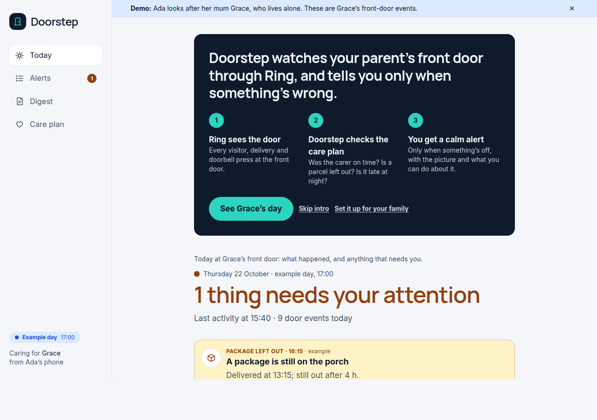
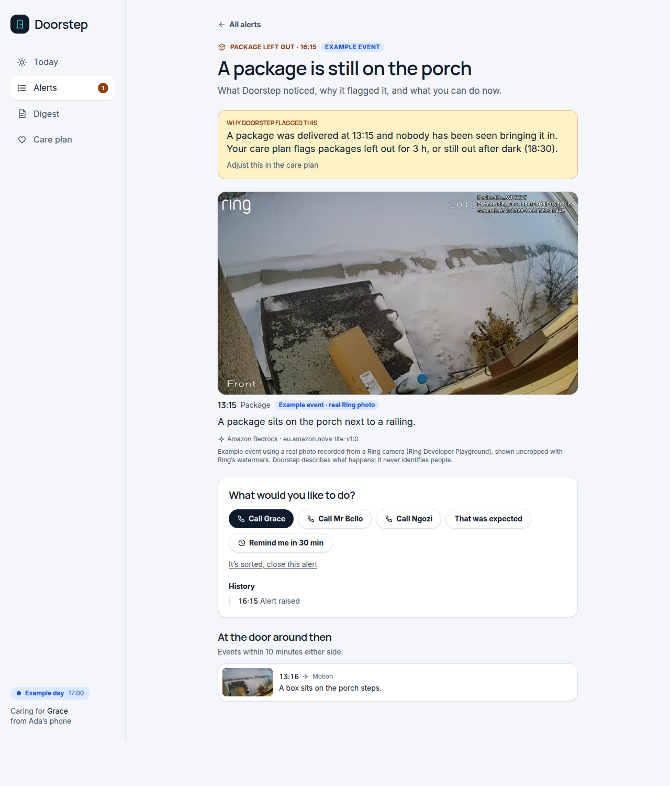
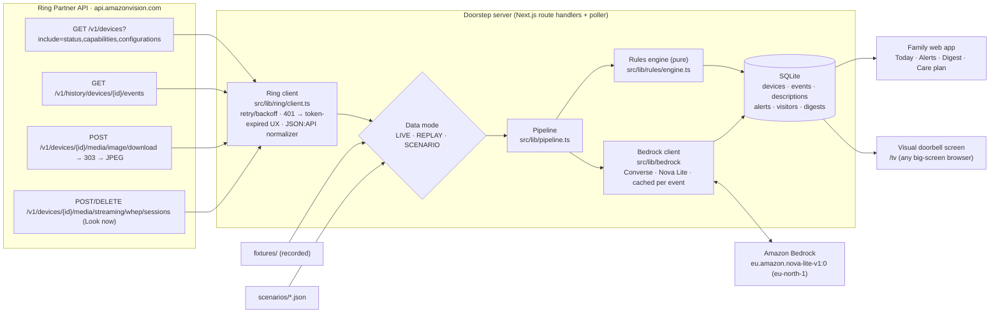

# Doorstep

**A caretaking companion for families looking after a parent who lives alone, built on the Ring Partner API and Amazon Bedrock.**

> Ada lives in another city. Her mother Grace lives alone. Doorstep tells Ada when something is off, and leaves her alone when it isn't.

Doorstep turns raw Ring front-door events into calm, plain-language information a family member actually wants:

- **AI event descriptions.** Each Ring snapshot is sent to Amazon Bedrock (Nova Lite) to be described in one plain sentence, e.g. *"A parcel is on the front steps and nobody is around."* It describes what happens and **never identifies people**. Real Nova Lite captions for every recorded and example event ship in `fixtures/captions.json`, imported by `npm run setup` (refresh with `npm run warm:captions`). If Bedrock is ever unavailable, the app shows clearly labelled **sample captions** and switches back automatically. Our account's quota was 0 until Oct 22; see FRICTION_LOG F-08.
- **Caretaking alerts** from a deterministic, unit-tested rules engine: quiet morning, missed visit, package left out, late-night door activity, unanswered doorbell (best-effort).
- **Alerts that explain themselves.** Each alert opens to the full snapshot, its caption, and a care-plan-specific reason ("Doorbell at 23:41 — outside Grace's usual hours, 05:00–23:00"), plus what else happened at the door within ±10 minutes.
- **Caretaker actions.** Call Grace or the aide/neighbour through a call sheet (name, role and number; **Call now** on phones, **Copy number** on computers), **That was expected** (optionally add the visitor to the schedule), or **Remind me in 30 min**, with a per-alert history. Unacknowledged urgent alerts escalate in-app to a second family contact after 15 minutes.
- **Look now:** a WebRTC live view of the Ring camera from an alert page, via the Partner API's WHEP endpoint. The SDP exchange is proxied server-side, so the token never reaches the browser. It's verified against the Ring Developer Playground: 1280×720 video in about 10 s, and the session is closed cleanly on exit. It appears whenever a Ring token is connected.
- **Daily digest.** A short, warm note on the parent's day at the door, written by Bedrock (or, while Bedrock is unavailable, a labelled template).
- **Visual doorbell for the living room.** A full-screen, high-contrast "someone is at the door" page (`/tv`), for deaf or hard-of-hearing residents who can't hear the chime. It runs in any big-screen browser. (A native Fire TV app was planned; we dropped it, see friction log F-14.)

**First visit** explains itself in five seconds, then **See Grace's day** loads an example day:



| Today: one calm alert, visits, the door's timeline | Alert detail: real Ring photo, why it fired, what to do |
|---|---|
|  |  |
| **Recorded Ring Developer Playground events**, captioned by Amazon Bedrock (Nova Lite) | **Daily digest** written by Nova Lite |
|  |  |
| **Demo controls** with Ada's phone preview | **Visual doorbell** (`/tv`) for residents who can't hear the chime |
|  |  |

> Captions in these screenshots are real Amazon Bedrock (Nova Lite) output. Example-day pictures are labelled by source:
> - **real Ring photo:** frames recorded from the Ring Developer Playground, with Ring's watermark;
> - **stock photo:** credited in [assets/CREDITS.md](assets/CREDITS.md);
> - **illustration.**
>
> Nothing on an example day is presented as a real visit.

## Run it (under 5 commands)

```bash
git clone https://github.com/breakthrough-child/doorstep.git && cd doorstep
npm install
npm run setup
npm run dev
```

Open <http://localhost:3000>. A short explainer says what Doorstep does; **See Grace's day** loads an example day with an alert. Open **<http://localhost:3000/demo>** to switch data modes and play scenarios. Add `?intro=off` to any URL to hide the intro and story banner.

No credentials are needed for a first run: recorded Ring data, example days, and the recorded real Nova Lite captions from `fixtures/captions.json`. New events without credentials get labelled sample captions. To use real services, copy `.env.example` to `.env.local` and add AWS credentials (Bedrock, default `eu-north-1` with `eu.amazon.nova-lite-v1:0`) and/or a Ring Developer Playground token. Check Bedrock access with `npm run check:bedrock`. See [docs/AWS.md](docs/AWS.md).

Requirements: Node 20.9+ (tested on Node 22, Ubuntu 24.04). `better-sqlite3` ships prebuilt binaries for common platforms.

## Public read-only demo

`DOORSTEP_PUBLIC_DEMO=1` runs a safe, public version. It opens straight onto Grace's example day, with the recorded Ring data and the **real Nova Lite captions** recorded in `fixtures/captions.json`. LIVE mode, Ring token entry, Look now and all Bedrock calls are disabled, so the server needs no secrets, and a banner says it's a demo.

- **Deploy on Render (free plan):** New → Blueprint → pick this repo. `render.yaml` does the rest. The SQLite database is rebuilt on each start.
- **Run it locally the same way:**

```bash
DOORSTEP_PUBLIC_DEMO=1 npm run setup && DOORSTEP_PUBLIC_DEMO=1 npm run build && DOORSTEP_PUBLIC_DEMO=1 npm start
```

## Data modes: what's live, what's replayed, what's simulated

The Ring Developer Playground gives sandbox API access without hardware, but its tokens last ~30 minutes and **it doesn't deliver webhooks**. So Doorstep has three data modes. The mode names appear only in `/demo`; the app shows a plain-words badge on every screen.

| Mode | Badge | Ring data | Events | Snapshots |
|---|---|---|---|---|
| `LIVE` | **Live from Ring** (green) | Real Playground API calls with your token | Polled from Event History every 30 s | Real, watermarked Ring images |
| `REPLAY` (default) | **Recorded from a Ring camera** (blue) | Real Playground responses recorded on Oct 21 in `fixtures/playground/` (devices, 6 history events: package, vehicle and motion simulations), pushed through the same JSON:API normalizer | Recorded events, time-shifted to today | Real 1920×1080 Ring snapshots with the mandatory watermark |
| `SCENARIO` | **Example day** (blue) | Replayed devices | Timed synthetic events on a simulated clock, each labelled "Example event" | Real recorded Ring frames where the scene fits (parcel, cars, bird feeder), one CC BY-SA stock photo (empty porch), otherwise illustrations. Each is labelled by source; there are no fake Ring images. |

- Record your own fixtures: trigger a few event simulations in the Playground, then `RING_ACCESS_TOKEN=… npm run record`. A fresh token has an empty history, so simulate first. The token is never written to disk; the recorder refuses to save any file containing it.
- Scenarios: `grace_normal_day`, `missed_aide_visit`, `package_left_out`, `quiet_morning`, `late_night_ding`. Play at 1×/10×/60×/300× from `/demo`.
- **Coverage-aware.** The Playground only authorizes data from each token's issue time. Doorstep tracks when its view of the door began ("watching since 23:43") and never raises "nobody came" alerts for time it couldn't see.
- The Playground's simulated events all arrive as `on_demand` (live view) with no package/person subtype (friction F-12). That's why the caretaking rules are demonstrated with labelled SCENARIO days.

## Architecture



- **Ring client** (`src/lib/ring/`): typed responses, `?include=` + `included` resolution by type+id, newest-first pagination via `links.next` `page[key]`, exponential backoff that honours `Retry-After` on 429/5xx, `RingTokenExpiredError` on 401 driving the "paste a new Playground token" banner, and the snapshot 303 → pre-signed URL hop done manually without forwarding the Bearer token. It's imported and called at runtime by the poller, the token-check endpoint, the Look now proxy and the fixture recorder.
- **Pipeline** (`src/lib/pipeline.ts`): ingest → snapshot → Bedrock caption → rules → alerts. Single-flight `tick()` run by a 1.5 s poller (`src/instrumentation.ts`) and nudged by page requests, which never wait on it. Captions run in the background, so slow Bedrock calls never block the UI.
- **Rules engine** (`src/lib/rules/engine.ts`): pure functions of (events, care plan, now), evaluated in the parent's time zone, with deterministic alert ids so a family's actions survive re-evaluation. A pure `explainAlert` writes each alert's care-plan-specific "why". Covered by Vitest, including DST days.
- **Bedrock** (`src/lib/bedrock/`): Converse with image + text in, strict JSON out, tolerant parsing with fallbacks, results cached by event id, token usage logged per call. If Bedrock is unavailable (our account's Nova Lite quota was 0 until Oct 22, see the friction log), events get clearly labelled sample captions and the app switches to real captions automatically once calls succeed. Details and costs: [docs/AWS.md](docs/AWS.md).

## Privacy stance

- **No face recognition, no biometric matching, no identification. Ever.** The vision prompt forbids naming or recognising anyone or guessing personal traits. "Missed visit" means *nobody* came to the door in the window, not that a specific person didn't. Visitor names are labels for the family only.
- **Ring's watermark stays intact.** Snapshots are always displayed uncropped (`object-contain`) at full size.
- **Secrets stay server-side.** The Ring token and AWS credentials are only used in route handlers; the browser never receives them. Pasted tokens live in the local SQLite file (`data/`, git-ignored).
- **Data stays local.** Everything is stored in a local SQLite file. Snapshots go to Amazon Bedrock for captioning (AWS states Bedrock doesn't use customer inputs to train models) and nowhere else.
- Doorstep reads privacy-zone and end-to-end-encryption settings from device configurations. E2EE devices aren't exposed by the Partner API at all.

## Tests

```bash
npm test
```

Vitest (105 tests) covers:
- every alert rule (edge cases, wrapping late-night windows, DST spring-forward/fall-back, other time zones, coverage);
- the care-plan explanations;
- caretaker actions, reminders and escalation, against a temporary database;
- JSON:API normalization, using real recorded Playground responses;
- the Ring client (retry/backoff, 401, pagination, the snapshot redirect, WHEP open/close);
- model-output parsing and the replay loader;
- that each scenario fires exactly the alerts it's designed to show;
- that every file path referenced in code and docs exists.

## Project docs

- [SUBMISSION.md](SUBMISSION.md): Devpost answers and product feedback
- [FRICTION_LOG.md](FRICTION_LOG.md): every real problem we hit with Ring, the Playground, Bedrock and Vega
- [DECISIONS.md](DECISIONS.md): defaults chosen and why
- [DEVPOST_CHECKLIST.md](DEVPOST_CHECKLIST.md): what to paste where on Devpost
- [DEMO_SCRIPT.md](DEMO_SCRIPT.md) and [RECORDING_CHECKLIST.md](RECORDING_CHECKLIST.md): video script and recording setup
- [docs/AWS.md](docs/AWS.md): AWS integration, measured tokens, latency and cost
- [docs/DESIGN.md](docs/DESIGN.md): visual identity and WCAG contrast table
- [assets/CREDITS.md](assets/CREDITS.md): image credits and licences

## License

MIT. See [LICENSE](LICENSE).
