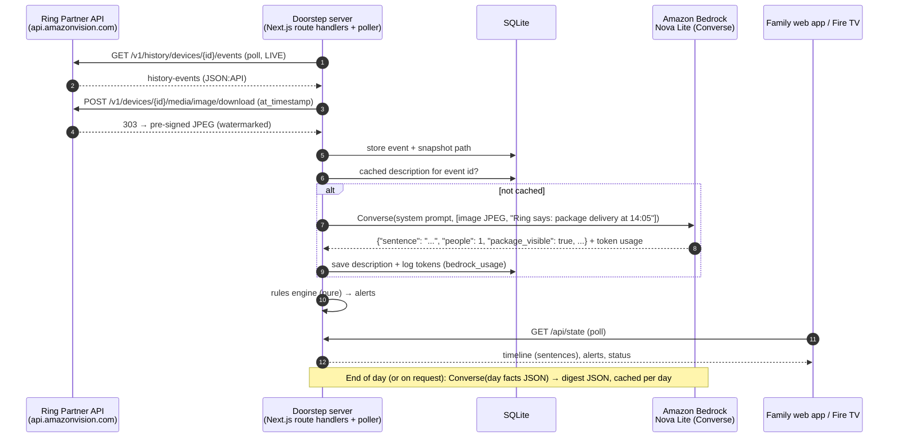

# AWS integration — Amazon Bedrock

Doorstep uses **Amazon Bedrock** (Converse API, `@aws-sdk/client-bedrock-runtime`) with **Amazon Nova Lite** for the two jobs where a model beats rules: describing what a Ring snapshot shows, and writing a warm daily summary. The caretaking alerts are a deterministic rules engine, not AI.

## Services used

| Service | What for | Where in code |
|---|---|---|
| Amazon Bedrock Runtime — `Converse` | Snapshot → one plain sentence + structured tags (image + text in, JSON out) | `src/lib/bedrock/index.ts` → `describeSnapshot()` |
| Amazon Bedrock Runtime — `Converse` | Day's events + alerts → short digest (text in, JSON out) | `src/lib/bedrock/index.ts` → `writeDigest()` |
| Amazon Nova Lite (`us.amazon.nova-lite-v1:0`, US cross-region inference profile from `us-east-1`) | Multimodal model for both calls | `BEDROCK_MODEL_ID` env var |

No other AWS services are needed. Persistence is local SQLite, so judges run the app with zero cloud setup.

## Why Bedrock + Nova Lite

- **One multimodal model for both jobs.** Nova Lite takes the JPEG directly in a Converse `image` block. There's no separate vision service and no image upload to S3.
- **Cost.** A Ring snapshot is roughly 1,300–1,800 input tokens. At Nova Lite's on-demand price, captioning a whole day of door events costs a fraction of a cent (see Cost below).
- **Privacy controls in the prompt.** The system prompt forbids identifying people or guessing personal traits, and tells the model to ignore Ring's watermark overlay. Doorstep never does face recognition or biometric matching, by design.
- **Converse API** gives one request shape across Bedrock models, so swapping to Nova 2 Lite or another vision model is an env-var change.

## Data flow



- **Secrets stay server-side.** Bedrock and Ring are only called from route handlers and the poller. The browser never sees AWS credentials or the Ring token.
- **Caching.** Descriptions are keyed by event id and digests by `(data origin, local date)`. Restarting a demo scenario reuses its captions, so a result is never paid for twice.
- **Fallbacks.** Strict JSON parsing (zod) with lenient recovery: the first balanced JSON object, then the first prose sentence. If Bedrock fails 3 times for an event, the event gets a plain "event type" caption labelled as such. Digest output that won't parse falls back to a deterministic template.
- **Mock mode.** `BEDROCK_MOCK=1` returns canned outputs of the same shape for offline development. When unset, Doorstep calls Bedrock if AWS credentials are discoverable and mocks otherwise. The UI labels each caption's source (Bedrock model id, mock, or event-type only).

## Usage logging

Every call logs model, input/output tokens and latency to the console (`[bedrock] describe … in=… out=…`) and to the `bedrock_usage` table. The `/demo` panel shows running totals.

## Cost

Nova Lite on-demand pricing (us-east-1, check the current Bedrock pricing page): about **$0.00006 per 1K input tokens** and **$0.00024 per 1K output tokens**.

| Call | Typical tokens | Approx. cost |
|---|---|---|
| Snapshot caption | ~1,500 in / ~60 out | ~$0.0001 |
| Daily digest | ~900 in / ~150 out | ~$0.0001 |
| A busy day (40 events + digest) | | **< $0.01** |
| Whole hackathon build + demo recording | | **cents** |

(Measured numbers from real runs are in the friction log / submission once recorded.)

## Setup

1. AWS account with Bedrock in `us-east-1`. Amazon's serverless models are enabled for invocation by default in commercial regions (the old per-model "Model access" page was retired). If your account or organization restricts model access via IAM/SCP, allow `bedrock:InvokeModel` on the Nova Lite inference profile and its underlying model in each region the profile routes to (`us-east-1`, `us-east-2`, `us-west-2`).
2. Minimal IAM policy for the credentials Doorstep uses:

```json
{
  "Version": "2012-10-17",
  "Statement": [
    {
      "Effect": "Allow",
      "Action": ["bedrock:InvokeModel"],
      "Resource": [
        "arn:aws:bedrock:us-east-1:*:inference-profile/us.amazon.nova-lite-v1:0",
        "arn:aws:bedrock:*::foundation-model/amazon.nova-lite-v1:0"
      ]
    }
  ]
}
```

3. Put `AWS_ACCESS_KEY_ID`, `AWS_SECRET_ACCESS_KEY`, `AWS_REGION=us-east-1` in `.env.local` (or use `AWS_PROFILE`/SSO). Restart `npm run dev`.
