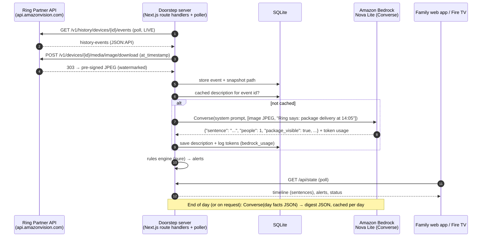

# AWS integration — Amazon Bedrock

> **Status (Thu Oct 22): live.**
> - The account's Nova Lite quotas were 0 until about 15:27 WAT on Oct 22, when the quota request and support case 179260552100186 came through (FRICTION_LOG F-08).
> - Every recorded Ring frame and example event now has a real Nova Lite caption, cached in SQLite.
> - Run `npm run check:bedrock` to test an account with one real call, and `npm run warm:captions` to pre-caption all events.

Doorstep uses **Amazon Bedrock** (Converse API, `@aws-sdk/client-bedrock-runtime`) with **Amazon Nova Lite** for the two jobs where a model beats rules: describing what a Ring snapshot shows, and writing a warm daily summary. The caretaking alerts are a deterministic rules engine, not AI.

## Services used

| Service | What for | Where in code |
|---|---|---|
| Amazon Bedrock Runtime — `Converse` | Snapshot → one plain sentence + structured tags (image + text in, JSON out) | `src/lib/bedrock/index.ts` → `describeSnapshot()` |
| Amazon Bedrock Runtime — `Converse` | Day's events + alerts → short digest (text in, JSON out) | `src/lib/bedrock/index.ts` → `writeDigest()` |
| Amazon Nova Lite (`eu.amazon.nova-lite-v1:0`, EU cross-region inference profile, called from `eu-north-1`) | Multimodal model for both calls | `BEDROCK_MODEL_ID` / `AWS_REGION` env vars |

No other AWS services are needed. Persistence is local SQLite, so judges run the app with zero cloud setup.

## Why Bedrock + Nova Lite

- **One multimodal model for both jobs.** Nova Lite takes the JPEG directly in a Converse `image` block. There's no separate vision service and no image upload to S3.
- **Cost.** A Ring snapshot is roughly 1,300–1,800 input tokens. At Nova Lite's on-demand price, captioning a whole day of door events costs a fraction of a cent (see Cost below).
- **Privacy controls in the prompt.** The system prompt forbids identifying people or guessing personal traits, and tells the model to ignore Ring's watermark overlay. Doorstep never does face recognition or biometric matching, by design.
- **Converse API** gives one request shape across Bedrock models, so swapping to Nova 2 Lite or another vision model is an env-var change.

## Data flow



- **Secrets stay server-side.** Bedrock and Ring are only called from route handlers and the poller. The browser never sees AWS credentials or the Ring token.
- **Caching.** Descriptions are keyed by event id and digests by `(data origin, local date)`. Restarting a demo scenario reuses its captions, so a result is never paid for twice.
- **Fallbacks.** Strict JSON parsing (zod) with lenient recovery: the first balanced JSON object, then the first prose sentence. If Bedrock fails 3 times for an event, the event gets a plain "event type" caption labelled as such. Digest output that won't parse falls back to a deterministic template.
- **Real by default, with labelled samples as fallback.** With AWS credentials present, every caption is first attempted on Bedrock. If a call fails (quota, access, network), the exact error is recorded and the event gets a **sample caption**, labelled "Sample caption — Amazon Bedrock not available yet" in the UI. Bedrock is retried after a cooldown (10 min for daily-quota errors). The first success switches back to Nova Lite and re-captions the samples in the background. Digests behave the same way.
- **Mock mode.** `BEDROCK_MOCK=1` never calls AWS; it uses the same sample captions, labelled as mock-mode samples.
- **Health check.** `npm run check:bedrock` makes one real Nova Lite call (image + text) and prints the caption and token usage, or the exact error name, HTTP status, request id and a hint. If the app's database exists, it also updates the app's Bedrock status immediately.

## Usage logging

Every call logs model, input/output tokens and latency to the console (`[bedrock] describe … in=… out=…`) and to the `bedrock_usage` table. The `/demo` panel shows running totals.

## Cost

Nova Lite on-demand pricing (check the current Bedrock pricing page for your region; EU profiles are priced close to us-east-1): about **$0.00006 per 1K input tokens** and **$0.00024 per 1K output tokens**.

| Call | Typical tokens | Approx. cost |
|---|---|---|
| Call (measured Oct 22, eu-north-1) | Tokens | Latency | Approx. cost |
|---|---|---|---|
| Snapshot caption (1080p JPEG + prompt) | ~2,350 in / ~45 out | 4–25 s (avg ~14 s) | ~$0.00015 |
| Daily digest (day's facts as JSON) | ~510 in / ~130 out | ~5 s | ~$0.00006 |
| Captioning every recorded and example event (47 calls) | 110,308 in / 2,122 out | — | **≈ $0.007** |
| A busy real day (40 events + digest) | ~95k in / ~2k out | — | **< $0.01** |

Latency is why captions run in the background: the UI shows the event immediately, and the caption fills in when Bedrock answers.

## Setup

1. AWS account with Bedrock in `eu-north-1` (or any region; in `us-east-1` use `us.amazon.nova-lite-v1:0`). **Check Service Quotas → Amazon Bedrock for Nova Lite in your region first.** New accounts can have on-demand quotas applied at 0 (F-08), which no IAM setting fixes. If your organization restricts model access via IAM/SCP, allow `bedrock:InvokeModel` on the inference profile and on the underlying foundation model in every region the EU profile routes to.
2. Minimal IAM policy for the credentials Doorstep uses:

```json
{
  "Version": "2012-10-17",
  "Statement": [
    {
      "Effect": "Allow",
      "Action": ["bedrock:InvokeModel"],
      "Resource": [
        "arn:aws:bedrock:eu-north-1:*:inference-profile/eu.amazon.nova-lite-v1:0",
        "arn:aws:bedrock:*::foundation-model/amazon.nova-lite-v1:0"
      ]
    }
  ]
}
```

3. Put `AWS_ACCESS_KEY_ID`, `AWS_SECRET_ACCESS_KEY`, `AWS_REGION=eu-north-1` (and optionally `BEDROCK_MODEL_ID`) in `.env.local`, or use `AWS_PROFILE`/SSO. Run `npm run check:bedrock`, then restart `npm run dev`.
